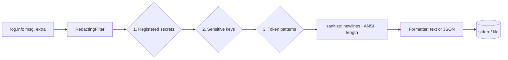

# safe-logger

[](https://github.com/sergiogoqui-cpu/safe-logger/actions/workflows/ci.yml)


Python logging that **cannot leak secrets** and **cannot be forged by untrusted input**. Drop it into the standard `logging` module: API keys, bearer tokens, passwords and private keys are masked before they reach the console, a file or your log aggregator. Zero dependencies.

```python
import logging
from safe_logger import setup_logging

setup_logging("INFO", secrets=["my-real-api-secret"])

log = logging.getLogger("app")
log.info("calling https://api.example.com/v1?api_key=abc123 with my-real-api-secret")
# 2026-10-15 12:00:00,000 INFO    app: calling https://api.example.com/v1?api_key=[REDACTED] with [REDACTED]
```

## Why

Logs are the most common accidental leak of credentials: a debug line prints a config object, an HTTP client logs a URL with a token, an exception message echoes a password. And anything user-controlled that you log (a username, a token name) can inject fake lines or terminal escape codes.

| Threat | What `safe-logger` does |
|---|---|
| A known secret ends up in a message | **Registered secrets** are masked in any format, anywhere |
| `password=...`, `"api_key": "..."` | **Sensitive keys** are masked in text, dicts and `extra=` fields |
| Bearer headers, JWTs, AWS/GitHub/Slack/Telegram tokens, PEM keys, URL credentials, EVM and long base58 keys | **Pattern detection** |
| Secrets inside tracebacks | Exception text is redacted too |
| Newlines forge log lines (log injection) | Newlines are escaped to `\n` |
| ANSI/control characters hijack the terminal | Stripped or replaced |
| Giant payloads flood the log | Truncated with a `[+N chars]` marker |

## How it works



Registered secrets are the most precise layer (load them from your config at startup). Keys and patterns are the safety net for what you didn't register.

## Install

```bash
pip install git+https://github.com/sergiogoqui-cpu/safe-logger.git
```

## Usage

### One-line setup (text or JSON, optional file)

```python
from safe_logger import setup_logging

setup_logging("INFO", secrets=[os.environ["API_SECRET"]], json_output=True, file="logs/app.jsonl")
```

JSON output is one object per line, with your `extra=` fields included:

```json
{"at": "2026-10-15T12:00:00.000+00:00", "level": "info", "logger": "app", "msg": "login", "user": "ana", "password": "[REDACTED]"}
```

### Keep your own handlers and formatters

```python
import logging
from safe_logger import RedactingFilter, Redactor

handler = logging.StreamHandler()
handler.addFilter(RedactingFilter(Redactor(["my-real-api-secret"])))
logging.getLogger().addHandler(handler)
```

### Register secrets as you learn them

```python
redactor = setup_logging("INFO")
redactor.register_secret(config.wallet_key)   # values shorter than 8 chars are ignored
```

### Redact data directly (not only logs)

```python
from safe_logger import Redactor

Redactor().redact_obj({"user": "ana", "password": "x", "nested": {"api_key": "y"}})
# {'user': 'ana', 'password': '[REDACTED]', 'nested': {'api_key': '[REDACTED]'}}
```

### Sanitise untrusted input

```python
from safe_logger import sanitize

log.info("user said: %s", sanitize(request.body))  # also applied automatically by setup_logging
```

### Extend it

```python
Redactor(
    extra_keys=["iban"],
    extra_patterns=[(r"ORD-\d{6}", "ORD-xxxxxx")],
)
```

## Limits (read this)

- Redaction is a **safety net, not a guarantee**. The first defence is not logging secrets at all.
- Pattern matching can miss unusual formats and can over-mask (any key containing `session` or `seed`, for instance). Register real secrets explicitly.
- It redacts what flows through `logging`. It does not scan third-party libraries that print directly to stdout.

## API

| Name | Purpose |
|---|---|
| `setup_logging(level, secrets, redactor, json_output, file, max_length)` | Configure the root logger; returns the `Redactor` |
| `Redactor(secrets, min_secret_length, extra_patterns, extra_keys)` | `redact(str)`, `redact_obj(data)`, `register_secret(value)` |
| `RedactingFilter(redactor, max_length)` | `logging.Filter` for your own handlers |
| `JsonFormatter` | One JSON object per line |
| `sanitize(text, max_length)` | Neutralise untrusted text |

## Development

```bash
pip install -e . pytest
pytest
```

## License

MIT. Issues and pull requests are welcome.
